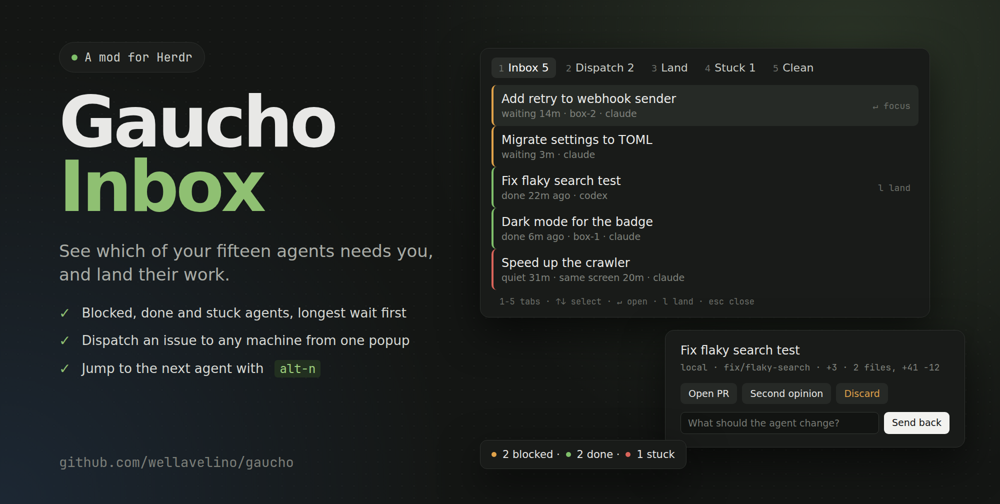

# Gaucho

Plugins for [Herdr](https://herdr.dev) that help you guide a herd of coding agents.

Herdr keeps your agents running. Gaucho keeps them moving: it shows you which
ones need you and gets you there quickly.

## Plugins

| Plugin | What it does |
| --- | --- |
| [Gaucho](plugins/hub) | Every screen of the plugins below in one popup, with live counts. |
| [Agent Inbox](plugins/agent-inbox) | Shows which agents on any machine need you, with a tab bar badge. |
| [Issue Dispatch](plugins/issue-dispatch) | Sends issues from any tracker to an agent on any machine, now or from a queue. |
| [Fleet Board](plugins/fleet-board) | Shows every agent, its state, and how long it has been there. |
| [Landing](plugins/landing) | Reviews finished work, then opens a PR, sends it back or discards it. |
| [Second Opinion](plugins/second-opinion) | Starts a fresh agent to review a finished branch. |
| [Stuck Detector](plugins/stuck-detector) | Flags agents that stopped making progress. |
| [Cleanup](plugins/cleanup) | Removes merged worktrees and branches on every machine. |

## Requirements

Gaucho is bash, and it needs these on the machine where you run Herdr:

| Tool | Used for | Needed by |
| --- | --- | --- |
| `git` | worktrees, branches, landing | everything |
| `jq` | all of Gaucho's data, which is JSON | everything, including the tab bar and the desktop app |
| `fzf` | the picker screens | the terminal plugins |
| `gum` | confirm prompts and the send-back box | the terminal plugins |
| `gh` | GitHub issues and pull requests, signed in with `gh auth login` | Issue Dispatch, Landing, Cleanup. Optional with your own [sources and forges](docs/extending.md) |

Herdr does not install them for you. Without `jq` the screens fail and the tab
bar entry stays empty. Install them first:

```sh
# Arch
sudo pacman -S git jq fzf gum github-cli
# macOS
brew install git jq fzf gum gh
# Debian and Ubuntu: gum and gh come from their own apt repositories,
# see github.com/charmbracelet/gum and cli.github.com
sudo apt install git jq fzf
```

Saved machines that only run agents need just `git` and `sh`, and SSH access
from the machine running Herdr. Gaucho runs where you sit, not where the
agents are.

## Install

Review a plugin before installing it: Herdr plugins run as your user and are
not sandboxed.

```sh
herdr plugin install wellavelino/gaucho/plugins/hub
```

That one popup opens every screen. To give screens their own keys, install
their plugins the same way, or all of them at once:

```sh
for p in hub agent-inbox issue-dispatch fleet-board landing second-opinion stuck-detector cleanup; do
  herdr plugin install wellavelino/gaucho/plugins/$p --yes
done
```

Each plugin's README has its key binding. Add the
[tab bar entry](plugins/agent-inbox#tab-bar) too, because it drives the background
work.

To work from a checkout:

```sh
git clone https://github.com/wellavelino/gaucho
herdr plugin link "$PWD/gaucho/plugins/agent-inbox"
```

## Desktop app

The Herdr desktop app has a different extension system, so it gets a
[popup and badge](app) on the same engine.

## Commands

### Keys

These are suggestions: add the ones you want to your Herdr `config.toml`. Each
plugin's README has the binding format. The prefix is your Herdr prefix key.

| Key | Action | Opens |
| --- | --- | --- |
| `prefix+a` | `gaucho.hub.open` | Gaucho, every screen |
| `prefix+i` | `gaucho.agent-inbox.open` | Agent Inbox |
| `prefix+shift+i` | `gaucho.issue-dispatch.open` | Issue Dispatch |
| `prefix+shift+q` | `gaucho.issue-dispatch.queue` | Dispatch queue |
| `prefix+shift+f` | `gaucho.fleet-board.open` | Fleet Board |
| `prefix+shift+l` | `gaucho.landing.open` | Landing |
| `prefix+shift+o` | `gaucho.second-opinion.open` | Second Opinion |
| `prefix+shift+s` | `gaucho.stuck-detector.open` | Stuck agents |
| `prefix+shift+c` | `gaucho.cleanup.open` | Cleanup |

In the desktop app, add these to `~/.config/herdr-app/keys.json` under `global`
(the [app guide](app) has the popup's own keys):

| Key | Action | Does |
| --- | --- | --- |
| `ctrl-shift-g` | `mod.open:gaucho` | Opens the Gaucho popup |
| `alt-n` | `gaucho-badge.next` | Focuses the agent that has waited longest |

### Engine

The plugins and the mod all call `core/gaucho`, and so can your scripts. `M` is
`local` or a saved machine. Commands print JSON unless they say otherwise, and
those marked `--tsv` can print tab-separated rows.

| Command | Does |
| --- | --- |
| `gaucho fleet [--tsv]` | Lists every agent on every machine |
| `gaucho inbox [--tsv]` | Lists blocked and finished agents |
| `gaucho stuck [--tsv]` | Lists agents that look stuck |
| `gaucho status [--no-work]` | Prints the tab bar summary and starts background work, unless `--no-work` |
| `gaucho machines` | Lists `local` and enabled machines |
| `gaucho read M ID [LINES]` | Prints an agent's recent output |
| `gaucho focus M ID` | Jumps to an agent |
| `gaucho prompt M ID TEXT` | Sends text to an agent |
| `gaucho sources` | Lists issue sources for the current repository |
| `gaucho source NAME VERB [ID]` | Calls a source directly |
| `gaucho dispatch [--clone] SOURCE ID M CWD` | Sends an issue to a new worktree and agent |
| `gaucho queue add SOURCE ID M CWD` | Adds an issue to the queue |
| `gaucho queue list [--tsv]` | Shows the queue |
| `gaucho queue rm REF` | Removes a queue item |
| `gaucho land-list [--tsv]` | Lists finished branches |
| `gaucho land-info M CWD [--json]` | Describes a branch and its pull request |
| `gaucho land-actions` | Lists landing steps |
| `gaucho land-action NAME M CWD [AGENT] [INPUT]` | Runs a landing step, with no confirmation |
| `gaucho review M CWD [WORKSPACE]` | Starts a second-opinion agent |
| `gaucho clean-list [--tsv]` | Lists worktrees and whether each is safe to remove |
| `gaucho clean M PATH` | Removes a merged worktree and its branch |
| `gaucho tick` | Delivers briefs, checks for stuck agents and moves the queue |
| `gaucho deliver` | Waits and sends held briefs |
| `gaucho background COMMAND...` | Runs a command detached and reports by notification |
| `gaucho job COMMAND...` | Runs a command detached for callers with a time limit |
| `gaucho jobs` | Prints finished job results once |
| `gaucho help` | Prints a short summary |

Add `--runtime NAME` before a command to choose a runtime, such as
`gaucho --runtime hc fleet`. Without it, Gaucho picks Herdr, then `hc`.

### Development

| Command | Does |
| --- | --- |
| `tests/run` | Runs the engine tests |
| `app/install.sh` | Installs the desktop mods |

## Extending

Add issue trackers, code hosts, stuck detectors, landing steps or whole runtimes
by dropping an executable in a folder. See [Extending Gaucho](docs/extending.md).

## Privacy

No telemetry, and no data leaves your machines through Gaucho itself. See
[SECURITY.md](SECURITY.md).

## Status

Early and small. Gaucho is a community project and is not affiliated with Herdr.

## License

[MIT](LICENSE)

<p align="center">
  
</p>
