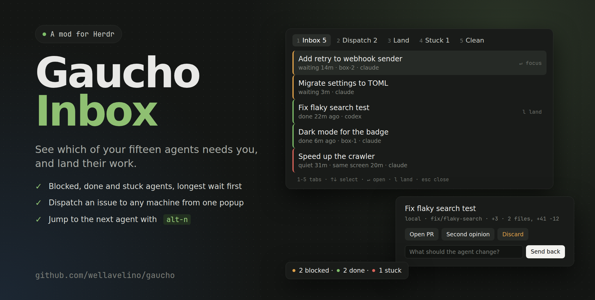

# Gaucho for the Herdr desktop app

The desktop app does not load `herdr-plugin.toml` plugins. It has JavaScript mods
and runs on herdr-core (`hc`), so Gaucho ships two mods on the same engine:

- **gaucho**: a popup with five tabs.
  - **Inbox**: agents that need you. Blocked first, then done, then stuck, longest
    wait first ("waiting 14m", "done 6m ago", "quiet 31m").
  - **Dispatch**: pick repo › source › issue › machine, then Start, Queue or
    Clone + start. Queued items can be removed.
  - **Land**: each finished branch, with Open PR, Second opinion, Discard (press
    twice within 3s) and its own Send back box.
  - **Stuck**: agents that stopped making progress, and why.
  - **Clean**: merged worktrees and branches on every machine.
- **gaucho-badge**: a 28px bottom bar, "2 blocked · 1 done · 1 stuck". Click it
  to open the popup.

Colours come from the app theme, so a theme change restyles both.

## Install

The mods run the same engine, so this machine needs `git` and `jq`, plus `gh`
for GitHub issues and pull requests. They don't use `fzf` or `gum`. See
[Requirements](../README.md#requirements).

```sh
app/install.sh
```

Then add the keys to `~/.config/herdr-app/keys.json`, under `global`:

```json
"ctrl-shift-g": "mod.open:gaucho",
"alt-n": "gaucho-badge.next"
```

The badge docks itself into the shown layout the first time Herdr sees it.
Herdr's own layouts are read-only, so clone one first and show the copy:

```sh
herdr-app do layout.clone '{"name":"main","as":"my-layout"}'
```

Run `app/install.sh` again after updating Gaucho.

## Keys

| Key | Where | Does |
| --- | --- | --- |
| `ctrl-shift-g` | anywhere | Opens or closes the popup |
| `alt-n` | anywhere | Focuses the agent that has waited longest (needs the badge shown) |
| `1`–`5` | popup | Inbox, Dispatch, Land, Stuck, Clean |
| `↑` `↓` | popup | Moves the selection |
| `↵` | popup | Focuses the agent (Inbox) or runs the selected item |
| `l` | Inbox | Lands the selected agent |
| `o` | Land | Second opinion on the selected branch |
| `⌫` | Dispatch | Goes back one step |
| `esc` | popup | Leaves a text box, else closes the popup |

## Notes

- Delivery, stuck detection and the queue run while the app is open. The badge
  runs them; without the badge, the open popup does.
- Status (blocked, done, idle) is live from Herdr's `agents()`. Wait times, stuck
  and runs come from the engine, which the badge reads every 20s and shares with the
  popup. An agent that changed status since that read is timed from when the mod saw it.
- The sidebar keeps Herdr's own sort (status first). Gaucho does not reorder it.
- The popup's Inbox also lists stuck agents and sorts by wait. The terminal Agent
  Inbox plugin lists only blocked and done agents.
- The mods use the `hc` runtime and keep their own state, separate from the plugins.
- Gaucho only sees agents that report status (OSC 7501).
- Dispatch reads issues from the focused local repository. A focused remote space
  has no local checkout, so open the repository locally to pick issues.
- `logic.js` holds the ordering, labels and key map. `node --test tests/` tests it;
  the badge ships a copy, and a test keeps the two the same.
